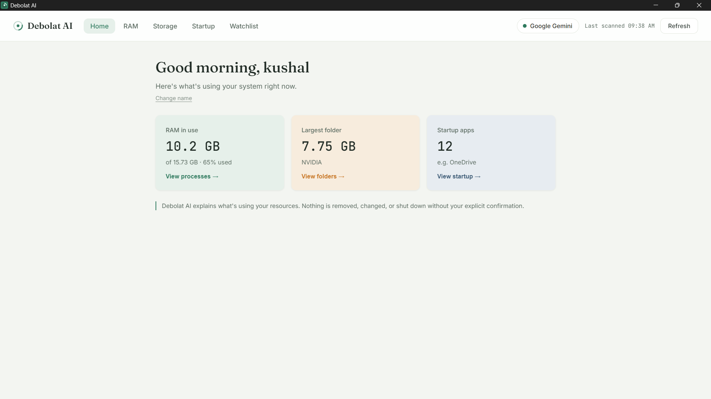
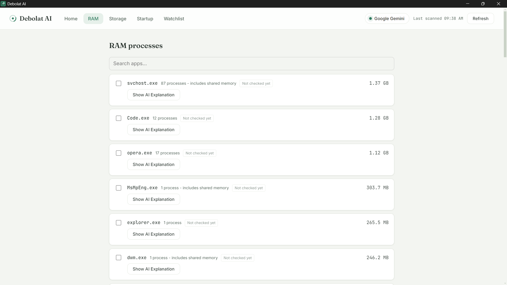
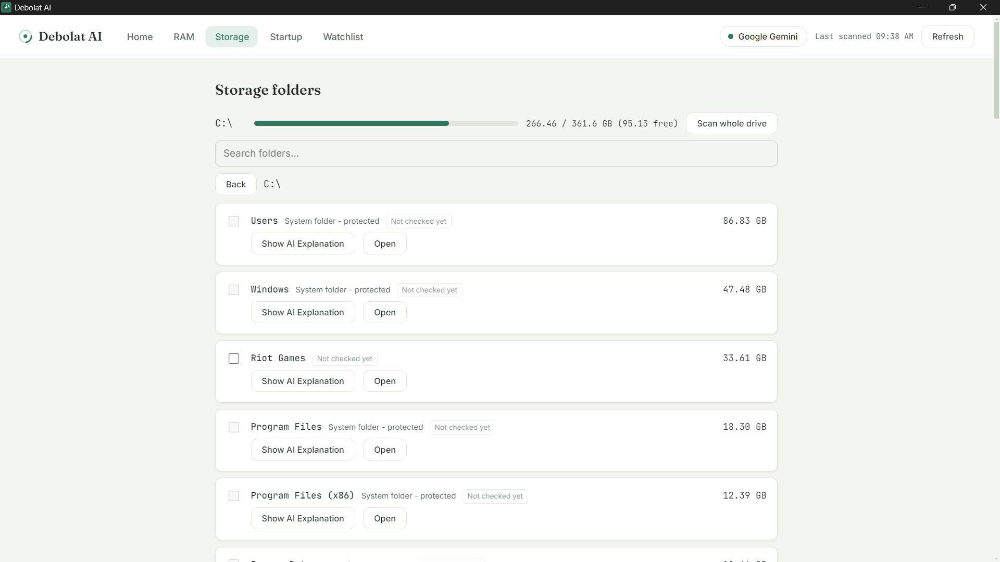
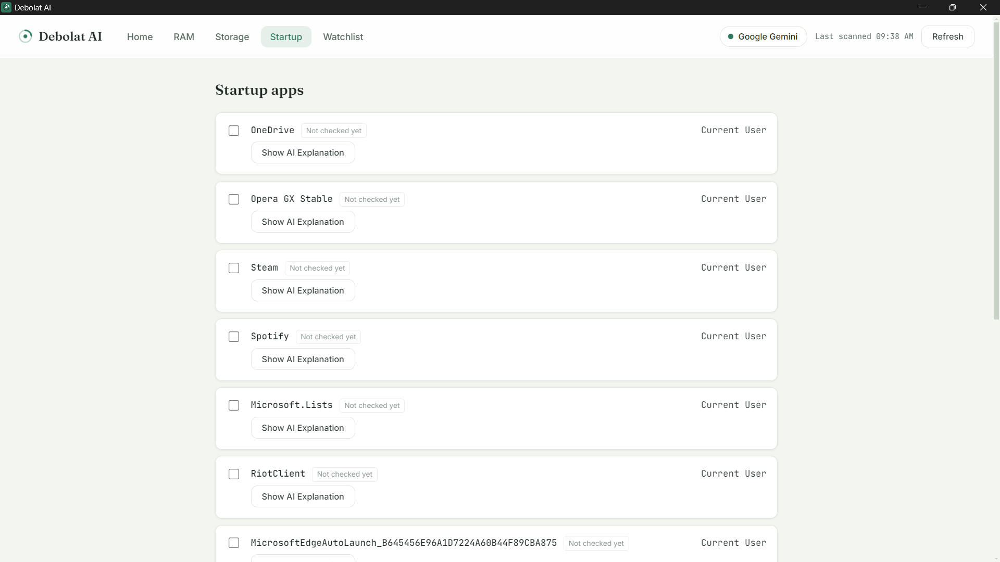
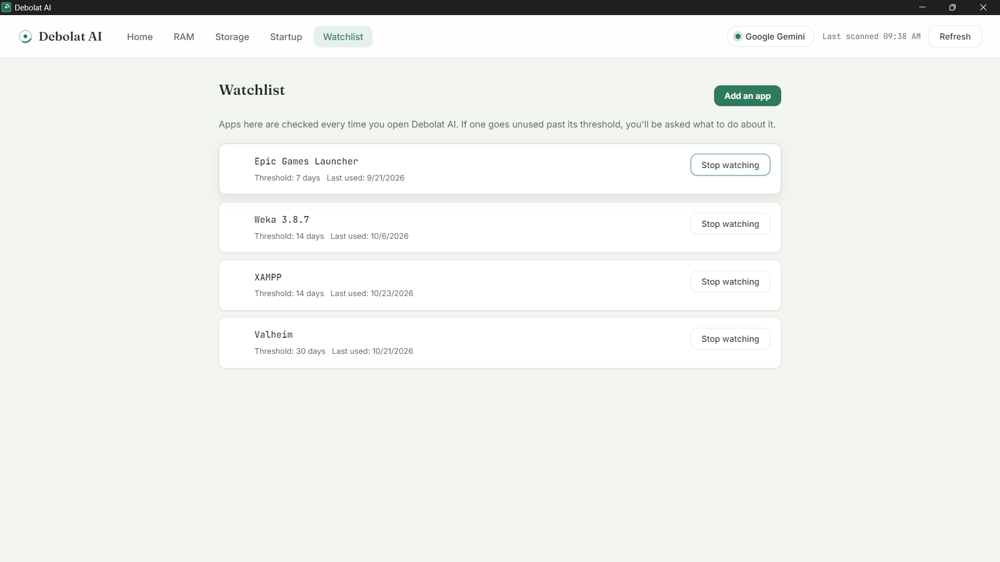
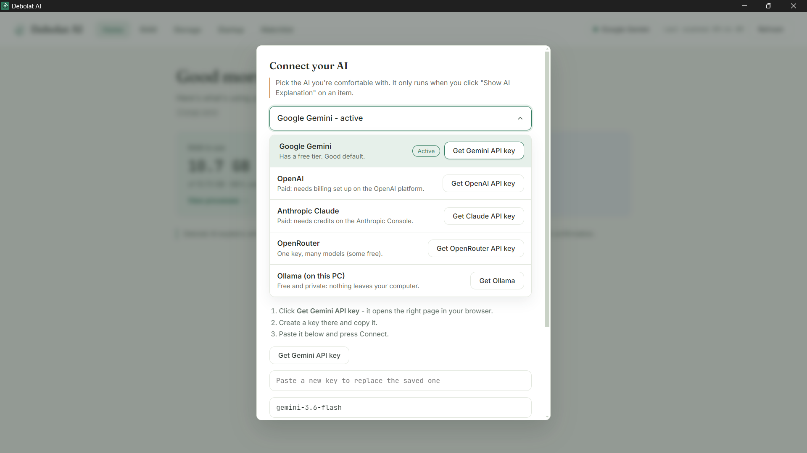
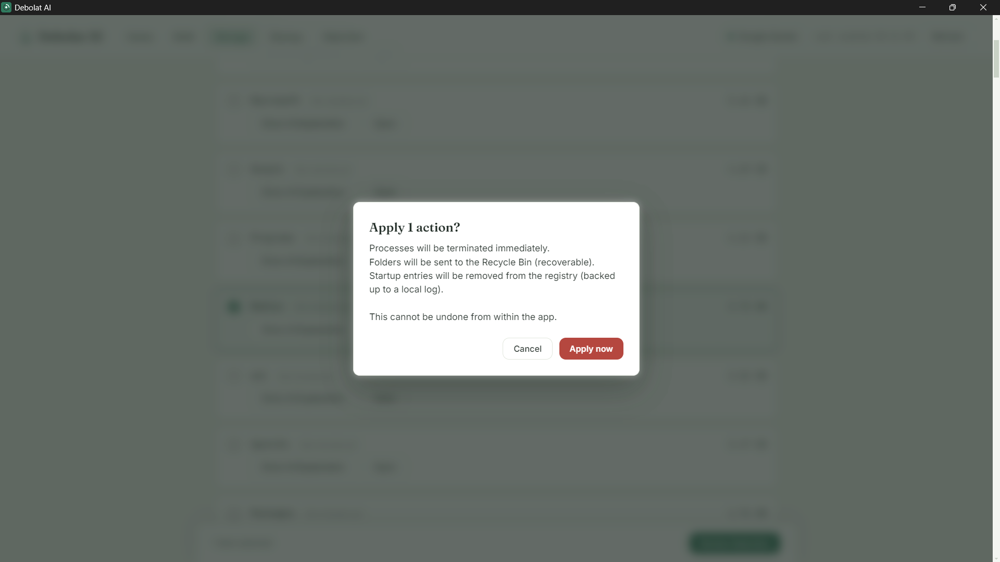
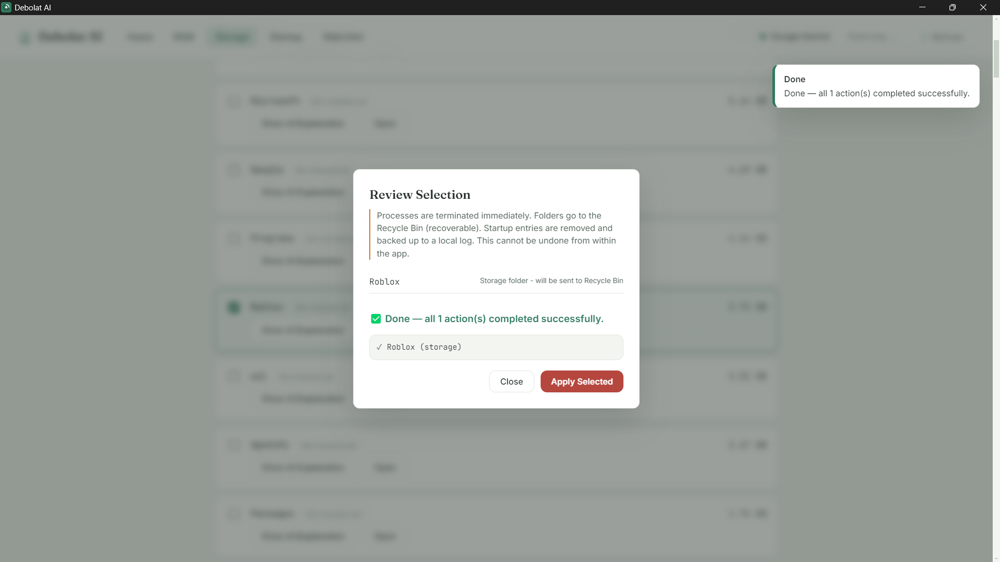

# Debolat AI

**Find out what is slowing down your Windows PC, in plain English, and decide what to do about it.**

Debolat AI scans your RAM, storage and startup apps, then uses the AI *you* choose to explain each item,
with a confidence level and a recommendation. **Nothing is removed, changed or shut down without your approval.**



## Download

Get the latest installer from the **[Releases page](../../releases/latest)**: download `DebolatAI-Setup-x.y.z.exe`,
double-click it, done. No Python or other tools needed.

> Windows may show a "SmartScreen" warning because the installer is not code-signed yet. Click **More info → Run anyway**.

## What it does

### See where your RAM goes
Processes are grouped by app (for example, all 12 `Code.exe` processes appear as one entry), with the real memory each app uses.



### Find what is eating your storage
See every drive, scan the whole thing, and drill into any folder. System folders are marked as protected.



### Control what starts with Windows
Every startup entry in one list, each with a plain-English explanation on request.



### Watch apps you never use
Add an app to the watchlist with a threshold. When it goes unused for too long, Debolat AI asks what you want to do.



## Bring your own AI

Click **Connect AI** in the top bar and pick the AI you are comfortable with. Each one has a button that opens the right page to get a key.
Supported: Google Gemini, OpenAI, Anthropic Claude, OpenRouter, and Ollama (runs on your PC, nothing leaves it).

The AI only runs when you click **Show AI Explanation** on an item. Nothing is sent during scanning, and your key is stored encrypted on your PC.



## You stay in control

Every change goes through a review step and a final confirmation. Folders go to the Recycle Bin (recoverable), and startup entries are backed up before removal.

| Review | Done |
|---|---|
|  |  |

## Principles

- **Real data only.** Everything shown comes from a real scan of your PC.
- **The AI says when it is unsure.** Low confidence is shown as such, not hidden.
- **You approve everything.**

## For developers

### Run from source
```
python -m venv .venv
.venv\Scripts\activate
pip install -r requirements.txt
npm install
npm start
```
Optional: copy `.env.example` to `.env` and add a Gemini key as a developer fallback.

### Build the installer
Double-click `build.bat` (or run it in a terminal). It
1. compiles the Python backend into `backend.exe` (PyInstaller),
2. self-tests it,
3. packages everything into `release\DebolatAI-Setup-<version>.exe` (electron-builder).

Change the version in `package.json` before each release.

### Where things are stored (installed app)
`%APPDATA%\Debolat AI\` holds the watchlist, the startup-removal backup and the (encrypted) AI key.
Uninstalling does not delete this folder.

### Adding another AI provider
Add one entry to `PROVIDERS` in `providers.py` (and one `_call_*` function if it is not
OpenAI-compatible). The Connect AI panel builds itself from that list.

## License

Copyright (c) 2026 Y. Kushal Goud. All rights reserved.
The source is viewable on GitHub. The installer is free for personal use. No redistribution or reverse engineering. See [LICENSE](LICENSE) for the full terms.
